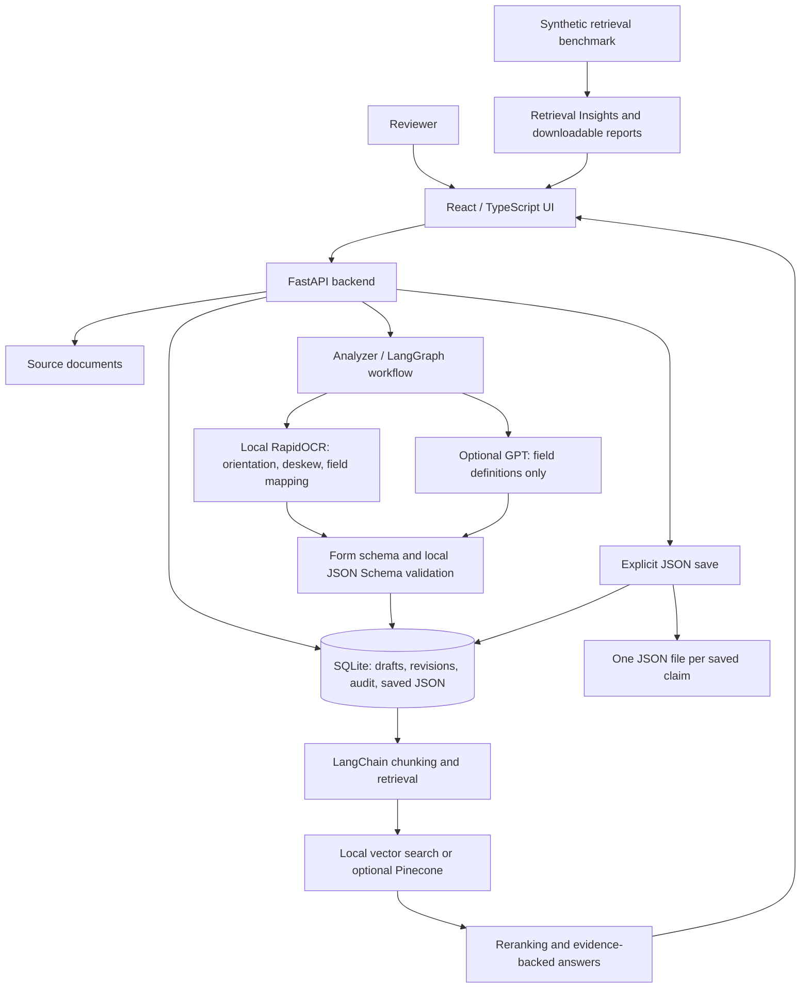

# Claims Processor — Architecture

A Replit-ready prototype for human-in-the-loop review of CMS-1450 and CMS-1500 claims.

## System overview

## Main components

| Component | Responsibility |
|---|---|
| React, TypeScript, Vite, PDF.js | Upload, source viewer, editable logical groups, JSON library and reports |
| FastAPI | Document APIs, revision checks, saves, analysis and question endpoints |
| RapidOCR, OpenCV, PyMuPDF | Local printed-text recognition, preprocessing and source coordinates |
| LangGraph | Checkpointed analysis/review/index workflow and retrieval/answer workflow |
| JSON Schema / optional GPT | Complete field definitions, local format checks and visible fallback status |
| SQLite and JSON files | Drafts, published records, original values, saved revisions and audit events |
| LangChain and vector adapters | Fixed-size versus logical chunking; local search or optional Pinecone |
| Reranker and evaluator | Candidate reordering and controlled retrieval-quality comparisons |

## Processing and storage

1. Upload creates a draft and displays the document; it does not start OCR or populate the library.
2. **Analyzer** performs OCR, detects the form, maps fields and generates a schema.
3. The reviewer checks source highlights, corrects fields and acknowledges unresolved issues.
4. An explicit save publishes one library record and updates `data/json/<claim-id>.json`.
5. JSON includes all defined fields, blanks, original values, schema, validation results and saved edit history.
6. Indexing enables claim-scoped questions with citations; edits require indexing the current revision again.

## Configuration and boundaries

- Default retrieval uses local hashed embeddings, lexical reranking and deterministic field lookup.
- MiniLM/cross-encoder adapters are available; Pinecone and GPT require server-side configuration.
- GPT receives field IDs/labels and form type for schema generation, not images, OCR text or claim values.
- Missing GPT credentials or generation failures produce a visibly labeled local schema fallback.
- Secrets belong in backend environment variables or Replit Secrets; they are excluded from client code and exports.
- Browser tests use an isolated backend/data directory; synthetic test uploads do not enter the user library.
- Handwriting, exhaustive payer rules and regulated production deployment remain outside verified scope.
